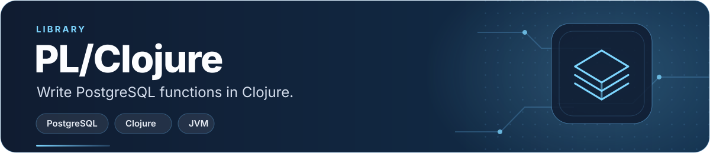

# 

A PostgreSQL procedural-language extension that connects database functions to Clojure and JVM libraries.

[Quick start](#quick-start) · [Validation](#validation) · [Project layout](#project-layout) · [Reference](#reference) · [License](#license)

## Quick start

Use a development PostgreSQL 14+ instance, a compatible JDK, and Leiningen. Read the reference for your toolchain and PostgreSQL headers, then install against the development instance.

```sh
./install.sh
```

## Validation

```sh
./test.sh
```

Run the integration checks against a disposable PostgreSQL instance.

## Project layout

| Path | Purpose |
| --- | --- |
| [`src/`](src/) | PostgreSQL/JVM bridge |
| [`lib/`](lib/) | Clojure implementation |
| [`install.sh`](install.sh) | Installation entry point |
| [`test.sh`](test.sh) | Integration checks |

## Reference

Read the [project reference](README.reference.md) for detailed examples, configuration, and original notes.

## License

See [`LICENSE`](LICENSE) for license terms.
